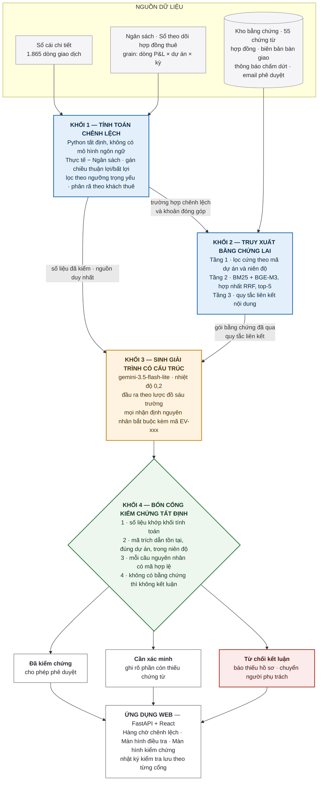
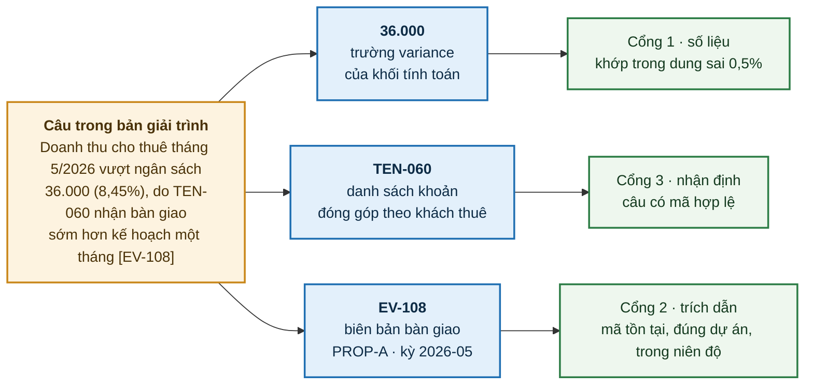

<div align="center">

# Comments_Variance

**Hệ thống sinh giải trình chênh lệch ngân sách có thể truy vết nguồn gốc**

Nghiệp vụ FP&A trong lĩnh vực bất động sản khu công nghiệp

[](#)
[](#)
[](#)
[](#)
[](https://comments-variance.vercel.app/)
[](thesis/)

[Demo trực tuyến](https://comments-variance.vercel.app/) · [Kiến trúc chi tiết](docs/architecture.md) · [Bảng thuật ngữ](docs/glossary.md) · [Khóa luận](thesis/)

</div>

---

> **Tóm lược.** Mô hình ngôn ngữ lớn soạn giải trình chênh lệch ngân sách rất nhanh, nhưng đầu ra không mang theo nguồn gốc: người duyệt không biết con số lấy từ dòng sổ nào, nguyên nhân dựa trên chứng từ nào, chỗ nào mô hình đang suy đoán. Repo này cài đặt một kiến trúc bốn khối tách phép tính và quyết định ra khỏi mô hình, buộc mọi nhận định nguyên nhân phải gắn mã chứng từ, và từ chối kết luận khi không đủ bằng chứng. Trên 306 lượt sinh có đáp án chuẩn, hệ thống đạt độ chính xác số liệu **98,4%**, độ chính xác trích dẫn **100,0%**, tỷ lệ nhận định thiếu căn cứ **5,4%** và từ chối đúng **100,0%** trên các trường hợp cố tình thiếu chứng từ.

**Mục lục**

1. [Vấn đề](#1-vấn-đề)
2. [Cách tiếp cận](#2-cách-tiếp-cận)
3. [Kiến trúc](#3-kiến-trúc)
4. [Đường truy vết của một nhận định](#4-đường-truy-vết-của-một-nhận-định)
5. [Thiết kế đánh giá](#5-thiết-kế-đánh-giá)
6. [Kết quả](#6-kết-quả)
7. [Chạy lại thí nghiệm](#7-chạy-lại-thí-nghiệm)
8. [Hạn chế đã biết](#8-hạn-chế-đã-biết)
9. [Cấu trúc repo](#9-cấu-trúc-repo)
10. [Dữ liệu và bảo mật](#10-dữ-liệu-và-bảo-mật)
11. [Trích dẫn và tài liệu tham khảo](#11-trích-dẫn-và-tài-liệu-tham-khảo)

---

## 1. Vấn đề

Mỗi kỳ chốt sổ, bộ phận FP&A phải giải trình vì sao kết quả thực tế lệch khỏi ngân sách. Đây là phần ban lãnh đạo thực sự đọc và là căn cứ để điều chỉnh vận hành. Với danh mục nhiều dự án và hàng trăm khách thuê, khối lượng giải trình tăng theo số dự án.

Mô hình ngôn ngữ lớn soạn được phần này rất nhanh, nhưng đầu ra không mang theo nguồn gốc. Vì việc kiểm tra tốn công hơn việc đọc, văn bản trôi chảy có xu hướng được phê duyệt mà không đối chiếu — đúng cơ chế lạm dụng tự động hóa mà Parasuraman và Riley (1997) mô tả. Một số liệu sai hoặc một nguyên nhân không có thật khi đó đi thẳng vào báo cáo quản trị và làm đứt dấu vết kiểm toán ngay tại khâu tạo văn bản.

Ba hạn chế kỹ thuật khiến cách dùng mô hình thông thường không giải quyết được vấn đề này:

| Hạn chế | Biểu hiện | Bằng chứng |
|---|---|---|
| **Mô hình không phải công cụ tính toán** | Dự đoán chuỗi từ theo phân phối xác suất, không có cơ chế bảo đảm phép tính | 65,05% trên các tác vụ suy luận số học của FinQA, so với 91,16% của chuyên gia (Chen và cộng sự, 2021) |
| **Tìm kiếm vector không mã hóa độ lớn** | Hai phát biểu về 100 tỷ và 120 tỷ có độ tương đồng rất cao, dù khoảng cách giữa chúng là biến động cần giải trình | Wallace và cộng sự (2019); Thawani và cộng sự (2021) |
| **Bộ tự đánh giá vẫn là mạng nơ-ron** | Self-RAG và CRAG lọc tài liệu bằng chính mô hình xác suất, nên hành vi không tái lập và không giải thích được cho người kiểm toán | Asai và cộng sự (2024); Yan và cộng sự (2024) |

> **Câu hỏi của đề tài.** Thiết kế hệ thống như thế nào để mọi con số truy được về sổ sách, mọi nhận định nguyên nhân gắn được với chứng từ, và hệ thống biết từ chối kết luận khi không đủ bằng chứng.

---

## 2. Cách tiếp cận

Nguyên tắc nền: **không giao cho mô hình ngôn ngữ những việc mô hình không có cơ chế bảo đảm.**

| Việc | Giao cho | Lý do |
|---|---|---|
| Tính chênh lệch, phân rã theo khách thuê, lọc khoản trọng yếu | Mã Python tất định | Phép tính phải tái lập được và khớp sổ sách |
| Xác định tài liệu nào liên quan | Quy tắc logic: khớp mã giao dịch, khớp tên dòng P&L, hoặc trùng tối thiểu hai từ khóa sổ cái | Điểm tương đồng vector không phải bằng chứng về sự liên quan |
| Diễn đạt thành văn bản theo biểu mẫu | Mô hình ngôn ngữ | Đây là việc mô hình làm tốt |
| Chấp nhận hay chặn đầu ra | Bốn cổng kiểm tra bằng mã | Người duyệt cần kết luận tất định, không phải một điểm tin cậy |
| Quyết định có kết luận hay không | Điều kiện về sự tồn tại của bằng chứng hợp lệ | Thiếu chứng từ thì phản hồi đúng duy nhất là báo thiếu hồ sơ |

Kết quả là mỗi câu trong bản giải trình có đường đối chiếu riêng: số về một trường trong kết quả khối tính toán, nguyên nhân về một mã chứng từ đúng dự án và đúng kỳ kế toán.

---

## 3. Kiến trúc



<table>
<tr><td width="33%" valign="top">

**Xanh — tất định**

Khối 1 và Khối 2. Python thuần, cùng đầu vào luôn cho cùng đầu ra.

</td><td width="33%" valign="top">

**Vàng — xác suất**

Khối 3. Phần duy nhất có mô hình ngôn ngữ, và chỉ được làm một việc: diễn đạt.

</td><td width="33%" valign="top">

**Xanh lá — chốt kiểm soát**

Khối 4. Nguyên tắc đóng lỗi: vi phạm bất kỳ cổng nào thì không xuất bản.

</td></tr>
</table>

Vận hành không cần giao diện: `vwb/experiments/run_benchmark.py` chạy toàn bộ luồng headless trên bộ trường hợp đã đóng băng và xuất `results/summary.csv`. Dữ liệu nguồn do `vwb/data_synth/generate.py` sinh với `SEED = 26`, lưu trong SQLite. Chi tiết hợp đồng dữ liệu: [`docs/architecture.md`](docs/architecture.md).

---

## 4. Đường truy vết của một nhận định

Ví dụ thật từ bộ thí nghiệm, trường hợp `2026-05_PROP-A_Leasing_revenue`.



Trên giao diện, người duyệt bấm vào con số thì ra dòng sổ gốc, bấm vào nguyên nhân thì ra tài liệu chứng minh. Không cần đọc lại toàn bộ sổ sách để xác nhận một bản giải trình.

---

## 5. Thiết kế đánh giá

Ba cấu hình chạy trên cùng một mô hình, cùng tham số, cùng bộ trường hợp.

| Cấu hình | Đầu vào cho mô hình | Cơ chế kiểm soát |
|---|---|---|
| **M0** — mô hình trực tiếp | Bảng số liệu chênh lệch | Không có |
| **M1** — RAG không kiểm chứng | Số liệu + **cùng gói bằng chứng như M2** | Yêu cầu dẫn nguồn bằng câu lệnh, sinh tự do |
| **M2** — hệ thống đề xuất | Số liệu + cùng gói bằng chứng | Lược đồ đầu ra, ràng buộc trích dẫn, bốn cổng kiểm chứng, điều kiện từ chối |

M1 và M2 dùng chung khối truy xuất, nên chênh lệch M1–M2 không đến từ chất lượng bằng chứng mà từ tầng kiểm chứng. Đổi lại, thí nghiệm không đo riêng đóng góp của tầng truy xuất.

<details>
<summary><b>Thành phần bộ dữ liệu mô phỏng</b></summary>

| Thành phần | Quy mô |
|---|---|
| Khu công nghiệp × kỳ | 5 khu (PROP-A…E) × 12 tháng |
| Sổ cái chi tiết | 1.865 dòng |
| Kho bằng chứng | 55 chứng từ, kèm metadata và mã bằng chứng chuẩn |
| Trường hợp chênh lệch trọng yếu | 34 |
| Mã nguyên nhân kinh tế | 10, trong đó 9 xuất hiện ở vai trò nguyên nhân chính |
| Trường hợp bẫy (không có chứng từ giải thích) | 3 |
| Chứng từ gây nhiễu (đúng dự án, đúng kỳ, không mang bằng chứng) | 2 |
| Khóa ngẫu nhiên | `SEED = 26`, sinh lại nguyên vẹn |

Đáp án chuẩn được đóng băng trước khi chấm điểm. Mỗi lượt chạy ghi lại `model_id`, `prompt_version`, `dataset_version`, `seed` và kết quả từng cổng.

</details>

**Quy mô thực nghiệm:** 34 trường hợp × 3 cấu hình × 3 lượt chạy = **306 bản ghi**.

---

## 6. Kết quả

Giá trị là trung bình và độ lệch chuẩn của ba lượt chạy.

| Thước đo | M0 | M1 | **M2** |
|---|---:|---:|---:|
| Độ chính xác số liệu | 90,1% ± 2,6 | 96,0% ± 1,2 | **98,4% ± 0,4** |
| Độ chính xác trích dẫn | không áp dụng | 93,5% ± 0,1 | **100,0% ± 0,0** |
| Độ bao phủ trích dẫn | 0,0% ± 0,0 | 91,4% ± 1,9 | **95,2% ± 1,6** |
| Tỷ lệ nhận định thiếu căn cứ (càng thấp càng tốt) | 100,0% ± 0,0 | 29,3% ± 2,6 | **5,4% ± 1,9** |
| Từ chối đúng trên trường hợp bẫy | 11,1% ± 19,2 | 0,0% ± 0,0 | **100,0% ± 0,0** |

**Chỉ số chẩn đoán.** Tỷ lệ bao phủ đầu ra của M2 là 91,2% so với 92,2% của M1, nên mức chính xác của M2 không đến từ việc từ chối trên diện rộng; rủi ro trên phần đã nêu nguyên nhân bằng 0,0%. Ở khâu truy xuất, Recall@5 đạt 100,0% nhưng Precision@5 chỉ 33,8%.

> **Cách đọc hai con số 100,0%.** Cổng kiểm chứng trích dẫn loại ngay mã sai nên đầu ra đã xuất bản không thể chứa mã sai, và cổng từ chối chuyển trạng thái khi không có tài liệu nào vượt qua quy tắc liên kết. Hai chỉ số này đo **hiệu lực của cổng kiểm tra**, không đo năng lực chọn chứng từ của mô hình. Phần sau được đo bằng Precision@5, và 33,8% cho thấy còn nhiều chỗ để cải thiện.

---

## 7. Chạy lại thí nghiệm

Yêu cầu: Python 3.12+, Node 20+, và một `GEMINI_API_KEY`.

**Backend và bộ thí nghiệm**

```bash
cd app/backend
poetry install                   # thêm --extras dense nếu muốn BGE-M3 (kéo torch ~2,5GB)
# tạo .env với GEMINI_API_KEY=...

python -m vwb.data_synth.generate                 # sinh lại bộ dữ liệu, SEED = 26
python -m vwb.experiments.run_benchmark --mock    # chạy thử, không gọi API
python -m vwb.experiments.run_benchmark --k 3     # chạy đủ 306 lượt
```

Kết quả ghi vào `app/backend/results/summary.csv`. Cờ `--resume` tiếp tục một lượt chạy bị ngắt; `--smoke` chạy trên tập trường hợp rút gọn.

**Ứng dụng web**

```bash
# Terminal 1
cd app/backend && poetry run uvicorn main:app --reload

# Terminal 2
cd app/frontend && npm install && npm run dev
```

Nếu không cài nhánh `dense`, khối truy xuất tự rút về BM25 cộng lọc metadata. Đây cũng là cấu hình đang chạy trên bản triển khai công khai.

---

## 8. Hạn chế đã biết

Phần này nêu thẳng những gì repo **không** chứng minh được.

| Hạn chế | Chi tiết |
|---|---|
| **Dữ liệu** | Bộ dữ liệu là mô phỏng, 34 trường hợp trong một bối cảnh nghiệp vụ, phân bố không đều: nhóm lớn nhất có 14 trường hợp, nhóm nhỏ nhất có một |
| **Thiết lập thực nghiệm** | Một mô hình, một phiên bản câu lệnh, ba lượt chạy, không thực hiện kiểm định suy luận |
| **Không quy được đóng góp** | M2 thêm ba thành phần cùng lúc so với M1, nên chưa tách được mức đóng góp riêng của lược đồ đầu ra, ràng buộc trích dẫn và các cổng kiểm chứng |
| **Giới hạn của cổng kiểm chứng** | Bốn cổng kiểm tra giá trị số và tính hợp lệ của mã, nhưng **không** kiểm tra quan hệ suy luận giữa nội dung câu và nội dung tài liệu được dẫn. Lỗi còn lại ở nhóm sự kiện tài trợ vốn thuộc đúng khoảng trống này |
| **Kho bằng chứng** | Không tồn tại sẵn trong doanh nghiệp: tài liệu rải rác ở SharePoint, attachment hệ thống kế toán, email. Corpus trong repo là thiết bị nghiên cứu; triển khai thật đòi hỏi gom và gắn mã tài liệu trước |
| **Cách chấm điểm** | Chủ yếu tự động, chưa có đánh giá mù của chuyên viên FP&A về chất lượng lập luận |
| **Giao diện** | Minh họa luồng sử dụng và công cụ quan sát bốn cổng; chưa đo mức độ dễ dùng hay thời gian tiết kiệm |

Nhãn *đã kiểm chứng* chỉ có nghĩa đầu ra đã vượt qua các quy tắc được cài đặt. Nó không phải bảo đảm về tính đúng đắn của nội dung và không thay thế bước phê duyệt của con người.

---

## 9. Cấu trúc repo

```
Comments_Variance/
├── app/
│   ├── backend/
│   │   ├── main.py                      FastAPI — 10 endpoint phục vụ giao diện
│   │   └── vwb/
│   │       ├── config.py                SEED, GEN_MODEL, ngưỡng trọng yếu
│   │       ├── data_synth/generate.py   sinh bộ dữ liệu mô phỏng + đáp án chuẩn
│   │       ├── engine/core.py           KHỐI 1 — tính toán tất định
│   │       ├── retrieval/core.py        KHỐI 2 — BM25 + BGE-M3 + RRF + quy tắc liên kết
│   │       ├── generation/              KHỐI 3 — lược đồ đầu ra, câu lệnh, client Gemini
│   │       ├── verification/gates.py    KHỐI 4 — bốn cổng kiểm chứng
│   │       └── experiments/             run_benchmark, metrics, recompute
│   ├── frontend/                        React 18 + Vite + Tailwind
│   └── tools/                           script xuất hình và phụ lục cho khóa luận
├── docs/
│   ├── architecture.md                  kiến trúc chi tiết và hợp đồng dữ liệu
│   └── glossary.md                      bảng thuật ngữ cho người đọc không chuyên
├── thesis/                              bản thảo 5 chương, hình, phụ lục
├── phases/                              5 giai đoạn triển khai, mỗi giai đoạn một checklist
├── prompts/                             chuẩn viết mã và chuẩn viết khóa luận
├── handoff.md                           trạng thái dự án và nhật ký quyết định
└── Sample_FP&A/ · local_data/           dữ liệu doanh nghiệp — không commit
```

---

## 10. Dữ liệu và bảo mật

Toàn bộ dữ liệu trong repo là **mô phỏng**: năm khu công nghiệp PROP-A đến PROP-E trong 12 tháng, mô phỏng đúng *cấu trúc* bộ tệp hàng tháng của doanh nghiệp quan sát nhưng không chứa số liệu hay danh tính thực.

Phần khảo sát 17 báo cáo giải trình đã phê duyệt chỉ dùng để nhận diện nhóm nguyên nhân và phong cách lập luận. Dữ liệu này đã ẩn danh toàn bộ tên dự án, khách thuê, nhà thầu và số liệu tài chính, và không đưa vào môi trường thử nghiệm.

Hai thư mục `Sample_FP&A/` và `local_data/` chứa dữ liệu doanh nghiệp và không bao giờ được commit. Quy tắc chi tiết: [`CLAUDE.md`](CLAUDE.md), mục Bảo mật.

---

## 11. Trích dẫn và tài liệu tham khảo

```bibtex
@thesis{nguyen2026variance,
  author = {Nguyễn Đức Phú},
  title  = {Hệ thống sinh giải trình chênh lệch ngân sách có thể truy vết
            nguồn gốc cho nghiệp vụ FP\&A trong lĩnh vực bất động sản
            khu công nghiệp},
  type   = {Khóa luận tốt nghiệp},
  year   = {2026},
  url    = {https://comments-variance.vercel.app/}
}
```

---

<div align="center">
<sub>Mã nguồn phục vụ mục đích học thuật. Dữ liệu trong repo là mô phỏng.</sub>
</div>
