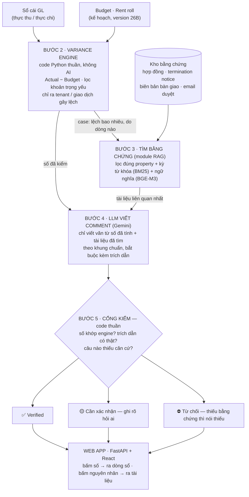
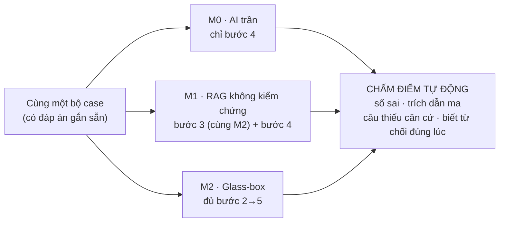

# System Architecture — Glass-Box Variance Commentary System

> Cập nhật: 2026-10-04. Kiến trúc cho MVP hoàn thành 18/10/2026.
> Nguyên tắc tối thượng (rút từ câu chuyện v2 — `objectives.md`): **LLM không bao giờ tính số; mọi con số và nhận định trong output phải truy vết được về nguồn; không đủ bằng chứng thì từ chối, không bịa.**

## 0. Phạm vi phân tích

Toàn bộ **P&L Actual vs Budget** theo `PL line × property × tháng` — đúng theo file `PL_Act vs budget` hàng tháng. **Trọng tâm kịch bản là leasing revenue** (sự kiện hợp đồng: ký mới, chấm dứt sớm, dời bàn giao, escalation, FX) vì đây là domain chính và là phần comments thật T1–T8 tập trung; các dòng chi phí (R&M, SG&A) vẫn thuộc scope với kịch bản riêng. **Không phải đề tài OPEX-only.** Ví dụ data contract ở §3 dùng một case chi phí để minh họa; case doanh thu giống hệt về cấu trúc — contributors khi đó là các sự kiện tenant (xem mock `docs/ui_mockup.html`).

## 0b. Kiểm tra thực tế — thành phần nào có thật, thành phần nào là thiết bị nghiên cứu

| Thành phần | Ngoài đời có thật không? | Ghi chú thành thật |
|---|---|---|
| GL Full (sổ cái) | **Thật** — tải từ NetSuite hàng tháng | Synthetic chỉ mô phỏng cấu trúc cột |
| Budget / rent roll theo tenant | **Thật** — file budget 26B | Cùng grain với actual |
| Mapping GL account → PL line | **Thật** — nằm trong file PL Act vs Budget (sheet Working/Output) | Hệ thống chỉ chuẩn hóa lại |
| Ngưỡng trọng yếu (materiality) | **Thật về hành vi** — analyst chỉ giải trình khoản lớn | Nhưng ngưỡng thường ngầm trong đầu; hệ thống buộc viết ra thành config — bản thân việc này là một giá trị |
| Cause taxonomy | **Thật** — rút từ comments đã duyệt T1–T8/2026 | Không bịa loại nguyên nhân nào |
| **Kho bằng chứng tập trung** | **KHÔNG có sẵn** — tài liệu rải rác (SharePoint, NetSuite attachment, Outlook, trí nhớ) | Corpus synthetic là *thiết bị nghiên cứu*; triển khai thật đòi hỏi doanh nghiệp gom tài liệu — nêu thẳng ở hạn chế C5 và là một khuyến nghị của đề tài |
| Verification gates | **Tự động hóa việc có thật** — người review đang dò số và hỏi "căn cứ đâu?" bằng tay | Không phát minh hành vi mới, chỉ làm máy thay người |
| Abstention (từ chối) | **Thật về nhu cầu** — analyst giỏi cũng nói "chưa rõ, để hỏi lại" | AI hiện tại không biết làm vậy — đó là gap |
| M0 (AI trần) | **Thật** — xấp xỉ cách dùng AI hiện tại trong quy trình ~1h | Baseline phản ánh hiện trạng |
| M1 (RAG không kiểm chứng) | **Thật** — đại diện cách dùng RAG phổ biến: truy xuất tốt nhưng để LLM viết tự do, không ai soát | Dùng CÙNG bộ bằng chứng với M2 → chênh lệch M1↔M2 quy được trọn cho schema + cổng kiểm (thí nghiệm một biến) |

## 1. Sơ đồ tổng



Ghi chú vận hành: `experiments/run_benchmark.py` chạy toàn bộ pipeline **headless** (không cần UI) trên frozen case set → `results/summary.csv` + hình cho Chương 4. Dữ liệu nguồn do `data_synth/generator.py` sinh với seed cố định (tái lập được): SQLite (properties, gl_transactions, budget, account_map, scenarios, gold_labels) + 60–100 evidence docs kèm metadata và gold evidence IDs.

## 2. Ba chế độ thí nghiệm (trục so sánh của khóa luận)

| Mode | Input cho LLM | Machinery |
|---|---|---|
| **M0 — LLM-only** | Bảng Budget/Actual thô của case | Không retrieval, không engine facts chi tiết, không verifier |
| **M1 — RAG không kiểm chứng** | Case + CÙNG evidence pack như M2 (metadata filter + BM25 + BGE-M3 + RRF, top-5) | Prompt tự do, không schema, không verifier |
| **M2 — Glass-box** | Engine facts package + hybrid retrieval + taxonomy | Schema bắt buộc + verification gates + abstention |

**Fairness:** cả 3 modes dùng CÙNG model, temperature, case set; M1 và M2 dùng CÙNG bộ bằng chứng truy xuất — M1↔M2 chỉ khác đúng một biến (schema + cổng kiểm + abstention), nên chênh lệch quy được cho verification machinery. Đổi lại, thí nghiệm KHÔNG đo riêng đóng góp của tầng truy xuất (metadata filter/RRF) — ghi nhận là hạn chế ở C4. Mỗi run ghi lại: `model_id`, `prompt_version`, `dataset_version`, `seed`, timestamp.



## 3. Hợp đồng dữ liệu (data contracts)

### VarianceCase (output của engine — nguồn sự thật về số)
```json
{
  "case_id": "2026-07_PROP-C_RM",
  "period": "2026-07", "ytd": false,
  "property": "PROP-C",
  "pl_line": "Repair & Maintenance",
  "gl_accounts": ["6321"],
  "budget": 120000.0, "actual": 182500.0,
  "variance": 62500.0, "variance_pct": 0.5208,
  "direction": "unfavorable", "material": true,
  "materiality_rule": "abs>=50000 AND pct>=0.10",
  "contributors": [
    {"txn_id": "GL-88412", "date": "2026-07-18", "vendor": "VND-012",
     "memo": "roof repair phase 2", "amount": 48200.0, "share": 0.77}
  ],
  "scenario_gold": "one_off_repair"   // chỉ tồn tại trong dataset, LLM không thấy
}
```

### Generation output (LLM phải trả đúng schema này)
```json
{
  "case_id": "2026-07_PROP-C_RM",
  "observed_facts":    [{"text": "...", "numbers": [{"value": 62500.0, "source": "engine:variance"}]}],
  "drivers_confirmed": [{"text": "...", "evidence_ids": ["EV-031"]}],
  "drivers_possible":  [{"text": "...", "evidence_ids": ["EV-044"], "note": "cần xác nhận"}],
  "unknowns":          ["..."],
  "draft_comment":     "RM vượt budget 62,500 (52%) do ... [EV-031]",
  "abstained": false
}
```

### Verification verdict (output của gates)
```json
{
  "numbers":  [{"value": 62500.0, "matched": "engine:variance", "pass": true}],
  "claims":   [{"sentence": "...", "evidence_id": "EV-031", "quote_found": true,
                "verdict": "supported"}],          // supported | unsupported | needs_confirmation
  "overall":  "verified"                            // verified | flagged | abstained
}
```

## 4. Thành phần chi tiết

### 4.1 `app/data_synth/` — bộ sinh dữ liệu
- `scenarios.yaml`: 8–10 kịch bản gieo, **doanh thu trước**: new lease sớm/trễ so với budget, early termination, dời bàn giao, rent escalation, FX; **chi phí sau**: one-off repair, timing shift, reversal/actual âm, budget = 0; và 2 kịch bản bẫy: **missing evidence** (test abstention), irrelevant-evidence-cùng-từ-khóa.
- `generator.py`: 5 properties (PROP-A…E) × 12 tháng × ~10 PL lines; GL transaction-level; ~25 material cases; seed cố định → **dataset_v1 đóng băng và commit**.
- Gold labels: case → {evidence_ids, cause, facts bắt buộc, claims bị cấm}.
- Schema các bảng mô phỏng đúng cấu trúc `Sample_FP&A/` (GL Full → gl_transactions; PL_26B → budget; sheet Output → pl_line mapping). **Chỉ mượn cấu trúc, không mượn dữ liệu.**

### 4.2 `app/backend/app/engine/` — variance engine
- Thuần pandas, có unit tests; materiality/ngưỡng nằm trong `config.py`, không hard-code.
- Không gọi LLM, không đọc evidence. Mọi số hệ thống hiển thị đều sinh từ đây.

### 4.3 `app/backend/app/retrieval/` — module RAG
- Index: metadata filter + BM25 (`rank-bm25`) + dense embeddings bằng **BGE-M3** (chạy local qua `FlagEmbedding`/sentence-transformers — đa ngôn ngữ, tốt cho tiếng Việt, miễn phí).
- Fusion (reciprocal rank) → top-k, trả kèm `retrieval_score` để abstention dùng.
- **Chiến lược precompute:** corpus và case là CỐ ĐỊNH → embed toàn bộ offline, lưu evidence pack per case vào SQLite. Web app lúc runtime KHÔNG cần load model embedding (Render free tier không gánh nổi ~2GB) — chỉ gọi LLM API khi bấm Generate.

### 4.4 `app/backend/app/generation/`
- Prompt templates versioned trong `prompts_llm/` (mỗi mode 1 template).
- Gọi LLM qua MỘT wrapper trung lập về nhà cung cấp (đổi model chỉ sửa config). Chốt hiện tại: **Gemini API** (Google AI Studio, free tier) — model thống nhất cho cả 3 modes, đề xuất `gemini-2.5-flash`; parse + retry khi vỡ schema.
- Free tier có rate limit → benchmark chạy tuần tự, có nghỉ giữa các call. Điều khoản free tier cho phép Google dùng dữ liệu gửi lên để cải thiện dịch vụ → **chỉ gửi dữ liệu synthetic** (quy tắc sẵn có của dự án — nêu lại trong chương bảo mật của khóa luận).

### 4.5 `app/backend/app/verification/`
- **Numeric gate**: regex/parser bóc mọi số trong comment → đối chiếu VarianceCase (khớp tuyệt đối hoặc làm tròn khai báo). Fail → gắn cờ đỏ từng số.
- **Citation gate**: evidence_id tồn tại? đoạn trích có thật trong doc không (quote match)?
- **Unsupported-claim flag**: câu nguyên nhân không có evidence hợp lệ → `unsupported`.
- **Abstention**: case gieo missing-evidence → hệ thống đúng khi TỪ CHỐI nêu nguyên nhân.
- Fail-closed: không verify được thì hiển thị là cờ, không bao giờ hiển thị như fact.

### 4.6 API (FastAPI)
```
GET  /api/cases?period=&property=      danh sách case + materiality
GET  /api/cases/{id}                   VarianceCase đầy đủ
GET  /api/cases/{id}/evidence          evidence pack (đã retrieve)
POST /api/cases/{id}/generate?mode=    m0|m1|m2 → generation output
POST /api/cases/{id}/verify            verdict
GET  /api/meta                         dataset_version, model_id, prompt_version
```

### 4.7 Frontend (React + Vite + TS + Tailwind) — 3 màn hình
1. **Variance Queue**: bảng case, filter property/period, badge material.
2. **Case Investigation**: số liệu bấm được → bảng GL contributors; driver bấm được → evidence panel (đoạn trích được highlight).
3. **Draft & Verify**: output 3 modes đặt cạnh nhau + verification badges (xanh/đỏ/vàng) + trạng thái abstained. *UI chính là cơ chế minh bạch — luận điểm "hộp kính" của đề tài.*

### 4.8 `app/experiments/` — benchmark headless
- `run_benchmark.py`: chạy 3 modes trên frozen set, lưu raw outputs + verdicts.
- `metrics.py`: numeric accuracy; traceability coverage; citation precision/recall (vs gold); unsupported-claim rate; abstention accuracy; retrieval P@5/R@5/MRR.
- Xuất `results/summary.csv` + hình matplotlib → `thesis/figures/`. **Kết quả Chương 4 sinh từ đây, không chép tay.**

## 5. Deploy
- Backend: Render/Railway (uvicorn + SQLite synthetic nằm trong repo — được phép vì là dữ liệu giả). Env: `GEMINI_API_KEY`. CORS mở cho domain frontend.
- Frontend: Vercel, env `VITE_API_URL`.
- Fallback nếu kẹt hạ tầng: docker-compose trên VPS, hoặc demo local + video quay sẵn (cut line cuối).

## 6. Tech stack

| Lớp | Chọn | Lý do |
|---|---|---|
| Ngôn ngữ backend | Python 3.12 | Kỹ năng sẵn có |
| API | FastAPI + uvicorn | Nhẹ, OpenAPI tự sinh |
| Data | SQLite + pandas | Đủ cho 5 properties, zero-ops |
| Retrieval | rank-bm25 + **BGE-M3** (local, precompute offline) | Hybrid, đa ngôn ngữ, miễn phí |
| LLM (generation) | Gemini API (AI Studio free tier) qua wrapper trung lập, 1 model cho cả 3 modes | Miễn phí để test, fairness |
| Quản lý thư viện | **Poetry** (`pyproject.toml` + commit `poetry.lock`) | Tái lập môi trường |
| Frontend | React + Vite + TS + Tailwind | User đã có kinh nghiệm |
| Test | pytest (engine + verification bắt buộc) | Phần tất định phải có test |
| Deploy | Render + Vercel | Free tier, nhanh |
