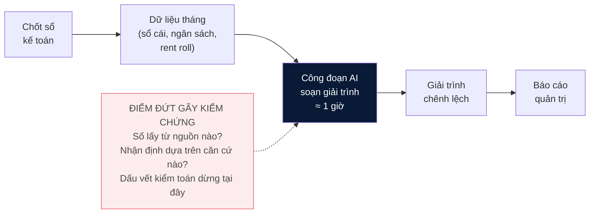

# PHẦN 1: GIỚI THIỆU

> **Trạng thái: DRAFT 2 — 04/10/2026** (formal hóa; mở đầu ngành + GenAI với nguồn sơ cấp CBRE Q2/2026; thêm Hình 1.1). Trích dẫn Harvard theo `docs/quy_dinh_vien.md`. Còn một chỗ chờ tác giả bổ sung (đánh dấu ⟦…⟧).

## 1.1. Bối cảnh nghiên cứu

Bất động sản khu công nghiệp hiện là một trong những phân khúc năng động nhất của thị trường bất động sản Việt Nam. Trong sáu tháng đầu năm 2026, GDP cả nước tăng 8,18% so với cùng kỳ — mức cao nhất của nửa đầu năm trong giai đoạn 2011–2026, ngoại trừ năm 2022; vốn đầu tư trực tiếp nước ngoài đăng ký đạt 34,65 tỷ USD, tăng 61% (CBRE Việt Nam, 2026). Trên nền đó, hấp thụ đất khu công nghiệp tại các thị trường cấp 1 miền Bắc đạt 217 ha riêng trong quý 2/2026 — mức cao nhất kể từ quý 1/2024; khu vực phía Nam đạt 124 ha trong nửa đầu năm, tăng 125% so với cùng kỳ. Động lực chính là hoạt động mở rộng của các nhà sản xuất điện tử và bán dẫn trong làn sóng đầu tư toàn cầu vào trí tuệ nhân tạo (CBRE Việt Nam, 2026). Với các chủ đầu tư vận hành danh mục gồm nhiều khu công nghiệp và hàng trăm khách thuê, tăng trưởng này đồng nghĩa với khối lượng báo cáo quản trị hàng tháng ngày càng lớn.

Làn sóng trí tuệ nhân tạo không chỉ tạo ra nhu cầu thuê đất; nó đồng thời đi vào chính bộ máy tài chính của doanh nghiệp. Theo khảo sát của Gartner trên 183 giám đốc tài chính, tỷ lệ bộ phận tài chính sử dụng AI đã tăng từ 37% năm 2023 lên 59% năm 2025 (Gartner, 2025). Doanh nghiệp bất động sản khu công nghiệp vì vậy đứng ở cả hai phía của làn sóng: hưởng lợi từ nhu cầu do AI tạo ra, và đối mặt với câu hỏi sử dụng AI như thế nào trong vận hành nội bộ — trong đó có quy trình báo cáo tài chính quản trị.

Trong quy trình đó, một nghiệp vụ lặp lại mỗi tháng giữ vai trò trung tâm: sau khi chốt sổ kế toán, bộ phận FP&A (Financial Planning & Analysis — hoạch định và phân tích tài chính) phải giải thích vì sao kết quả thực tế lệch so với ngân sách. Phần trả lời bằng văn bản được gọi là *variance commentary* (giải trình chênh lệch); các bảng số cho ban lãnh đạo biết mức lệch, còn giải trình cho biết nguyên nhân, và là phần được đọc kỹ nhất trước khi ra quyết định. Nghiên cứu này xuất phát từ quan sát trực tiếp của tác giả trong kỳ thực tập FP&A tại một doanh nghiệp bất động sản khu công nghiệp (thông tin doanh nghiệp được ẩn danh theo cam kết bảo mật). Phân tích 17 giải trình đã được phê duyệt trong tám tháng liên tiếp tại đơn vị cho thấy giải trình có chuẩn mực chặt chẽ: dung lượng ngắn, mỗi nguyên nhân gắn với một con số và một mốc thời gian, yếu tố bù trừ ngược chiều được tách riêng, và thường kèm ghi chú về khoản sẽ phát sinh ở kỳ kế tiếp.

Đáng chú ý, trí tuệ nhân tạo tạo sinh đã hiện diện trong chính nghiệp vụ này. Với sự hỗ trợ của *mô hình ngôn ngữ lớn* (Large Language Model — LLM, loại mô hình AI có khả năng đọc hiểu và tạo lập văn bản), toàn bộ công đoạn soạn giải trình hàng tháng tại đơn vị quan sát chỉ còn khoảng một giờ. Thực tiễn này cho thấy việc tạo lập giải trình không còn là trở ngại chính; vấn đề nghiên cứu nằm ở công đoạn tiếp theo — kiểm chứng kết quả do AI tạo ra.

## 1.2. Vấn đề nghiên cứu

Vấn đề không nằm ở tốc độ, mà ở khả năng kiểm chứng. Đối với người làm tài chính không có nền tảng lập trình, bước AI soạn giải trình là một *hộp đen (black box)*: người sử dụng không xác định được con số trong giải trình được lấy từ nguồn nào, nhận định nguyên nhân được suy ra bằng cách nào, và thời điểm nào mô hình đang suy đoán thay vì dựa trên dữ liệu. Niềm tin vào kết quả, nếu có, hình thành từ thói quen sử dụng — không phải từ khả năng truy vết.

Một văn bản trôi chảy nhưng không thể kiểm chứng tạo ra rủi ro thực chất. Nghiên cứu về tự động hóa đã chỉ ra hiện tượng *automation bias* (thiên lệch do tự động hóa): khi đầu ra của hệ thống có hình thức thuyết phục trong khi việc kiểm tra đòi hỏi nhiều công sức, con người có xu hướng phê duyệt mà không kiểm chứng (Parasuraman và Riley, 1997). Niềm tin phù hợp chỉ hình thành khi người sử dụng có phương tiện đánh giá đúng năng lực của hệ thống (Lee và See, 2004). Trong bối cảnh tài chính, một con số không khớp sổ sách hoặc một nguyên nhân do mô hình tự tạo ra có thể được đưa vào báo cáo quản trị, trong khi dấu vết kiểm toán bị gián đoạn tại chính công đoạn sinh văn bản. Bên cạnh đó, quy trình hiện tại phụ thuộc vào một cá nhân có khả năng điều khiển AI; tri thức này chưa được thể chế hóa thành quy trình có thể chuyển giao.

⟦Chờ tác giả bổ sung: một tình huống thực tế (đã ẩn danh) trong đó giải trình do AI soạn có hình thức hợp lý nhưng chứa con số hoặc nguyên nhân không có căn cứ, và cách sai sót được phát hiện.⟧

Vấn đề nghiên cứu được phát biểu như sau: **làm thế nào để thiết kế một hệ thống sinh giải trình chênh lệch ngân sách trong đó mọi con số truy vết được về sổ sách, mọi nhận định nguyên nhân truy vết được về bằng chứng, và hệ thống từ chối kết luận khi bằng chứng không đủ?**

Khoảng trống nghiên cứu được phân tích chi tiết ở Phần 2 và có thể tóm lược như sau: các nghiên cứu về LLM tập trung chủ yếu vào năng lực tạo lập văn bản; riêng với dữ liệu tài chính, các bộ dữ liệu chuẩn cho thấy LLM dễ mắc lỗi khi tự thực hiện phép tính (Chen và cộng sự, 2021; Zhu và cộng sự, 2021). Trong khi đó, nhu cầu của người dùng tài chính nằm ở chiều ngược lại: không phải văn bản hay hơn, mà là khả năng kiểm tra từng câu trong văn bản.

**Hình 1.1:** Quy trình giải trình hàng tháng tại doanh nghiệp quan sát và điểm đứt gãy kiểm chứng. *Nguồn: tác giả đề xuất.* <!-- Xuất PNG khi dựng bản Word -->

## 1.3. Mục tiêu, câu hỏi và giả thuyết nghiên cứu

Mục tiêu tổng quát của khóa luận là xây dựng và đánh giá một hệ thống sinh giải trình chênh lệch ngân sách **có thể kiểm chứng** — gọi là hệ thống *hộp kính (glass-box)*, đối lập với hộp đen. Khóa luận thuộc dạng nghiên cứu ứng dụng: vận dụng kiến thức về xử lý ngôn ngữ tự nhiên (NLP) và kỹ thuật sinh văn bản tăng cường truy xuất (RAG) để giải quyết một vấn đề cụ thể của doanh nghiệp, theo quy trình bốn bước — khảo sát vấn đề tại doanh nghiệp, xác định yêu cầu hệ thống, thiết kế và xây dựng, đánh giá thực nghiệm.

Mục tiêu cụ thể gồm ba phần: (i) thiết kế kiến trúc tách phần tính toán (do chương trình tất định thực hiện) khỏi phần diễn đạt (do LLM thực hiện), trong đó nhận định nguyên nhân phải gắn với bằng chứng được truy xuất; (ii) xây dựng bộ dữ liệu mô phỏng có đáp án chuẩn để đánh giá khách quan; (iii) so sánh định lượng hệ thống đề xuất với hai cách sử dụng AI phổ biến hiện nay.

Ba câu hỏi nghiên cứu tương ứng:

- **RQ1.** Hệ thống cần được thiết kế như thế nào để mọi con số và nhận định trong giải trình đều truy vết được về nguồn?
- **RQ2.** So với cách sử dụng LLM trực tiếp và cách kết hợp truy xuất tài liệu thông thường (vanilla RAG), kiến trúc đề xuất cải thiện ra sao về độ chính xác số liệu, độ chính xác trích dẫn và tỷ lệ nhận định thiếu căn cứ?
- **RQ3.** Hệ thống có từ chối kết luận đúng thời điểm khi bằng chứng không đủ hay không?

Từ RQ2 và RQ3, khóa luận kiểm định ba giả thuyết: **H1** — hệ thống đề xuất có tỷ lệ nhận định thiếu căn cứ thấp hơn hai phương án đối chứng; **H2** — hệ thống đề xuất có độ chính xác trích dẫn cao hơn phương án vanilla RAG; **H3** — hệ thống đề xuất từ chối đúng trên các tình huống thiếu bằng chứng với tỷ lệ cao hơn hai phương án đối chứng. Phương pháp kiểm định được trình bày ở Phần 3; kết quả đối chiếu từng giả thuyết được trình bày ở Phần 4.

## 1.4. Đối tượng và phạm vi nghiên cứu

Đối tượng nghiên cứu là quy trình giải trình chênh lệch giữa thực tế và ngân sách trên báo cáo kết quả kinh doanh (P&L) hàng tháng, ở mức dòng P&L theo từng khu công nghiệp, với trọng tâm là doanh thu cho thuê — mảng có các sự kiện nguyên nhân xác định được như chấm dứt hợp đồng trước hạn, điều chỉnh thời điểm bàn giao, hay điều chỉnh đơn giá theo hợp đồng.

Về dữ liệu, khóa luận sử dụng bộ dữ liệu **mô phỏng có đáp án chuẩn**, được xây dựng theo đúng cấu trúc bộ tệp hàng tháng của doanh nghiệp quan sát nhưng không chứa số liệu hay danh tính thực. Lựa chọn này xuất phát từ hai lý do: cam kết bảo mật dữ liệu doanh nghiệp, và yêu cầu phương pháp — việc chấm điểm khách quan đòi hỏi biết trước nguyên nhân thực của từng chênh lệch, điều dữ liệu thực không cung cấp. Chi tiết được trình bày ở Phần 3.

Ngoài phạm vi nghiên cứu: dự báo tài chính, tự động ra quyết định quản trị, tích hợp trực tiếp với hệ thống ERP, tinh chỉnh (fine-tune) mô hình ngôn ngữ, và kiểm chứng trên dữ liệu thực — các nội dung này được trình bày ở phần hạn chế và hướng phát triển.

## 1.5. Đóng góp dự kiến

Về học thuật, khóa luận đóng góp: (i) một kiến trúc hệ thống cùng các nguyên tắc thiết kế cho bài toán sinh giải trình tài chính kiểm chứng được; (ii) một bộ dữ liệu đánh giá công khai có đáp án chuẩn cho tác vụ giải trình chênh lệch ngân sách — theo khảo sát của tác giả, chưa có bộ tương tự được công bố; (iii) bằng chứng định lượng về mức cải thiện của cơ chế kiểm chứng so với hai cách sử dụng AI phổ biến.

Về thực tiễn, khung đánh giá của khóa luận là công cụ doanh nghiệp cần khi quyết định đưa AI vào quy trình báo cáo quản trị: thay vì đánh giá cảm tính, doanh nghiệp đo được tỷ lệ sai số, tỷ lệ trích dẫn sai và khả năng từ chối của hệ thống trước khi đưa vào sử dụng.

## 1.6. Cấu trúc khóa luận

Phần còn lại của khóa luận gồm bốn phần. Phần 2 tổng quan ba dòng nghiên cứu liên quan — giải trình chênh lệch trong FP&A; mô hình ngôn ngữ lớn và cơ chế gắn kết bằng chứng; niềm tin vào hệ thống tự động — và chỉ ra khoảng trống nghiên cứu. Phần 3 trình bày phương pháp: quy trình nghiên cứu ứng dụng bốn bước, thiết kế hệ thống, thiết kế dữ liệu mô phỏng và giao thức đánh giá. Phần 4 trình bày hệ thống hoàn chỉnh và kết quả thực nghiệm, đối chiếu với từng giả thuyết. Phần 5 kết luận, nêu đóng góp, hạn chế và hướng phát triển.

---

*Ghi chú biên tập (xóa trước khi nộp):* số liệu 1.1 lấy từ nguồn sơ cấp CBRE Hanoi/HCMC Figures Q2 2026 (PDF trong `materials/`, không công bố lại file) và press release Gartner 18/11/2025; danh mục nguồn ở `docs/02_khung_khoaluan_APA7.md` §3.7, reformat Harvard khi ghép toàn văn; Hình 1.1 xuất PNG khi dựng bản Word.
