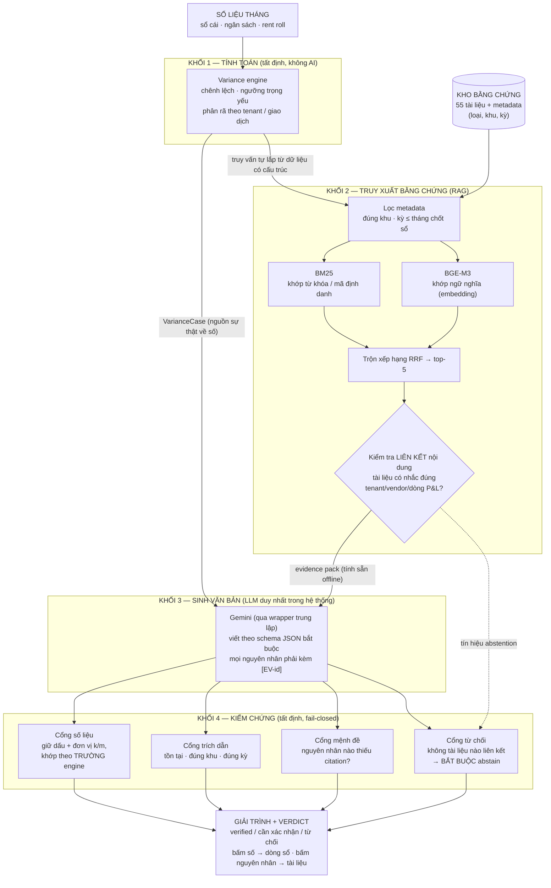

# PHẦN 3: PHƯƠNG PHÁP NGHIÊN CỨU

> **Trạng thái: 3.2 DRAFT XONG 10/10; 3.1/3.3/3.4 là khung chờ viết** (nguyên liệu đã có đủ: 3.1 từ dataset_v1 + house_style, 3.3 từ docs/paper_notes + phase3, 3.4 từ run_config).

## 3.1. Dữ liệu
*(khung — sẽ viết: 3.1.1 khảo sát 17 giải trình thật → taxonomy + khuôn viết; 3.1.2 sinh dữ liệu mô phỏng có đáp án, 12 kịch bản; 3.1.3 thống kê bộ dữ liệu: 5 khu, 60 khách thuê, 1.865 dòng sổ, 55 tài liệu, 34 tình huống)*

## 3.2. Mô hình và kiến trúc

### 3.2.1. Bài toán

Đầu vào của hệ thống gồm ba phần: (i) số liệu tháng có cấu trúc — sổ cái, ngân sách, rent roll; (ii) kho tài liệu bằng chứng, mỗi tài liệu kèm thông tin mô tả (loại, khu, kỳ); (iii) một tình huống chênh lệch cần giải trình. Đầu ra là bản giải trình trong đó **mọi con số truy vết được về một trường dữ liệu cụ thể của phần tính toán, mọi nhận định nguyên nhân kèm trích dẫn tới một tài liệu cụ thể**, và hệ thống từ chối nêu nguyên nhân khi kho không có bằng chứng phù hợp.

### 3.2.2. Kiến trúc tổng thể

**Hình 3.1: Kiến trúc hệ thống đề xuất.** *Nguồn: tác giả đề xuất.*

### 3.2.3. Luận giải từng thành phần: lý do — ưu điểm — hạn chế — nguồn tham khảo

**Bảng 3.1: Luận giải lựa chọn kỹ thuật.** *Nguồn: tác giả tổng hợp.*

| # | Thành phần (kỹ thuật) | Lý do chọn | Ưu điểm | Hạn chế | Tham khảo |
|---|---|---|---|---|---|
| 1 | **Variance engine** — chương trình tất định (pandas) | LLM sai số học trên dữ liệu tài chính (chuyên gia 91% vs model 65% trên FinQA); số trong báo cáo quản trị phải khớp sổ tuyệt đối | Đúng 100% và test được bằng số tính tay; rẻ; tái lập | Chỉ biết "cái gì", không biết "vì sao" — cần khối 2 bù | Chen và cộng sự (2021); Zhu và cộng sự (2021); nguyên tắc tách tính toán khỏi diễn đạt: Chen và cộng sự (2023) |
| 2 | **Lọc metadata** — luật cứng khu/kỳ | Chặn tài liệu trùng từ khóa nhưng sai khu (bẫy kiểu adversarial) và tài liệu phát sinh sau kỳ chốt sổ (nguyên tắc khóa sổ của kế toán) | Tất định, gần như miễn phí, giải thích được từng loại bỏ | Đòi metadata sạch — điều kiện triển khai thật phải nêu ở khuyến nghị | Thiết kế bẫy theo Rajpurkar, Jia và Liang (2018); yêu cầu kỳ chốt sổ: nghiệp vụ kế toán |
| 3 | **BM25** — truy xuất theo từ khóa | Tín hiệu mạnh nhất trong nghiệp vụ là mã định danh (TEN-014, VND-012) — khớp chính xác quan trọng hơn khớp nghĩa | Chính xác với mã/từ hiếm; không cần model; nhanh | Mù ngữ nghĩa: không biết "termination" ≈ "thanh lý" | Robertson và Zaragoza (2009) |
| 4 | **BGE-M3** — truy xuất theo nghĩa (dense embedding) | Bắt trường hợp lệch từ vựng (tài liệu thật viết tự do, trộn Anh–Việt); là cấu phần RAG ngữ nghĩa trong chương trình học | Hiểu nghĩa, đa ngôn ngữ, chạy local miễn phí, tính sẵn offline | Nặng (~2GB); "gần nghĩa" có thể gần nhầm chủ đề — phải đứng SAU lọc metadata | Lewis và cộng sự (2020) cho nguyên lý RAG; model: BGE-M3 ⟦verify: Chen và cộng sự, 2024, arXiv:2402.03216⟧ |
| 5 | **Trộn xếp hạng RRF** | Kết hợp hai bảng xếp hạng (từ khóa + ngữ nghĩa) không cần tinh chỉnh trọng số | Đơn giản, bền, không tham số phải học | Thô hơn các phương pháp trộn có học | ⟦verify: Cormack và cộng sự, 2009 — Reciprocal Rank Fusion, SIGIR⟧ |
| 6 | **Kiểm tra liên kết nội dung** — luật tất định quyết định abstention | Đo đạc thực tế (10/10/2026) cho thấy ngưỡng điểm BM25 thô không tách được case bẫy khỏi case thật (điểm không so sánh được giữa các case); "có bằng chứng" trong kế toán nghĩa là tài liệu nói về ĐÚNG giao dịch | Tất định, giải thích được từng quyết định từ chối; mô phỏng đúng câu hỏi của người duyệt | Luật cứng có thể bỏ sót cách diễn đạt lạ; chính nó được đo bằng abstain recall | Ý tưởng đánh giá chất lượng truy xuất trước khi sinh: Yan và cộng sự (2024); khung từ chối: Kamath, Jia và Liang (2020); Wen và cộng sự (2025) |
| 7 | **Sinh theo schema + trích dẫn bắt buộc** | Mỗi nhận định là một mục riêng kèm citation → chấm được ở mức mệnh đề nguyên tử; khuôn trình bày khớp chuẩn nhà (rút từ 17 giải trình thật) | Kiểm được từng câu; output máy đọc được; văn phong nhất quán | Gò bó so với văn tự do; phụ thuộc model tuân thủ schema (đã đo: model yếu vi phạm nhiều hơn — chính là lý do cần khối 4) | Gao, Yen, Yu và Chen (2023); Min và cộng sự (2023); khảo sát mục 3.1 |
| 8 | **Cổng kiểm chứng** — parser tất định sau sinh | LLM không tự kiểm được chính nó một cách đáng tin; kiểm toán đòi hỏi phán xử giải thích được, chạy đủ 100% các lần | Fail-closed; bắt đúng lớp lỗi nguy hiểm (sai dấu, sai đơn vị k/m, trích dẫn ma, nhận định vô căn cứ) | Chỉ bắt được lớp lỗi đã định nghĩa; độ tin của máy chấm phải được đối chiếu người chấm (Cohen's κ) | Giữ dấu/đơn vị: Zhu và cộng sự (2021); khớp theo trường: Chen và cộng sự (2021); khái niệm quy nguồn: Rashkin và cộng sự (2023); đối lập với kiểm bằng LLM: Es và cộng sự (2024); Zheng và cộng sự (2023) |
| 9 | **LLM sinh văn bản: Gemini qua wrapper trung lập** | Chi phí bằng 0 (free tier) phù hợp sinh viên; wrapper đổi model bằng một dòng config — cả ba cấu hình so sánh dùng CÙNG model để công bằng | Rẻ, nhanh, một điểm log duy nhất (model, prompt, token) | Phụ thuộc nhà cung cấp — bằng chứng thực tế: model 2.5-flash bị ngừng cung cấp giữa nghiên cứu; giới hạn quota free tier chi phối thiết kế thí nghiệm | Quyết định thiết kế của đề tài; rủi ro API nêu ở hạn chế, phương án model trọng số mở ở hướng phát triển |
| 10 | **Dữ liệu mô phỏng có đáp án chuẩn** | Bảo mật số liệu doanh nghiệp; chấm khách quan đòi hỏi biết trước nguyên nhân thật — dữ liệu thật không cung cấp | Chấm bằng máy, tái lập (seed cố định), công khai được; bẫy thiết kế có chủ đích | Giá trị ngoại suy sang dữ liệu thật còn hạn chế — nêu thẳng ở mục hạn chế | Cách dựng benchmark: Chen và cộng sự (2021); Gao, Yen, Yu và Chen (2023); thiết kế tình huống không-trả-lời-được: Rajpurkar, Jia và Liang (2018) |

Ba nguyên tắc xuyên suốt rút ra từ bảng trên, nêu tường minh để người đọc nắm logic thiết kế: **(1) mô hình học chỉ đứng ở đúng một khối** (sinh văn bản) — mọi phán xử trước và sau nó là chương trình tất định; **(2) mỗi lớp bảo vệ nhắm một lớp lỗi có tên** (lọc metadata chặn bẫy sai khu; cổng số chặn sai dấu/đơn vị; cổng mệnh đề chặn nhận định vô căn cứ; cổng từ chối chặn bịa khi thiếu bằng chứng); **(3) chính các cơ chế bảo vệ cũng bị đo** — độ tin máy chấm đối chiếu người chấm, luật liên kết đo bằng abstain recall.

## 3.3. Cơ chế đánh giá
*(khung — sẽ viết từ `docs/paper_notes.md`: 5 thước đo + nguồn; quy trình khách quan: đáp án chốt trước, chấm mù, Cohen's κ, định nghĩa tường minh "abstention accuracy" = recall lớp phải-từ-chối, báo kèm coverage–risk)*

## 3.4. Thiết lập thực nghiệm
*(khung — sẽ viết từ `results/run_config.json`: 3 cấu hình cùng model gemini-3.5-flash-lite, temperature 0.2, k=3 lần/tình huống, nhịp gọi theo giới hạn free tier 15 lần/phút, seed 26, git head)*
